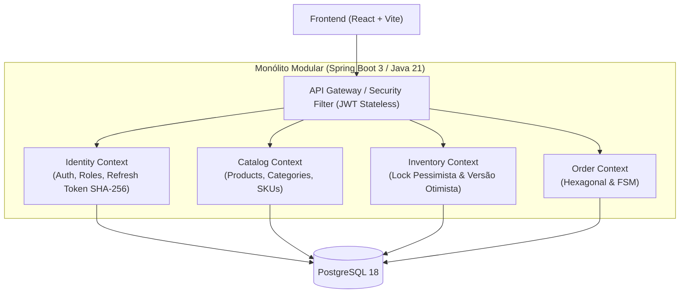

# DevUsa — Plataforma E‑commerce & Showcase de Arquitetura

[](https://github.com/SEU_USUARIO/devusa/actions)


> Plataforma completa de comércio eletrônico de moda desenvolvida como **projeto de portfólio de engenharia de software**. combina experiência visual minimalista com um **System Inspector ("Modo Engenheiro")** que mostra em tempo real o funcionamento dos Bounded Contexts, concorrência de estoque e máquina de estados.

---

## 🏛️ Visão Geral da Arquitetura

O projeto segue o padrão **Monólito Modular** com validação contínua via **ArchUnit**:



---

## 🔑 Diferenciais Técnicos Implementados

1. **Controle Estrito de Concorrência no Estoque** – reserva atômica com lock pessimista (`SELECT … FOR UPDATE`) e controle otimista via `@Version`.
2. **Máquina de Estados Finita (Order FSM)** – transições validadas (`AGUARDANDO_PAGAMENTO → PAGO → EM_SEPARACAO → ENVIADO → ENTREGUE`).
3. **Segurança & Tokens** – JWT de curta duração (15 min) + refresh tokens persistidos com hashing SHA‑256 e rotação obrigatória.
4. **Idempotência no Checkout** – cabeçalho `Idempotency-Key` obrigatório.
5. **System Inspector ("Modo Engenheiro")** – painel flutuante que exibe logs de eventos e permite acionar transições de estado ao vivo.

---

## 📂 Estrutura de Bounded Contexts

```text
com.devusa/
├── identity/   # Autenticação, usuários, JWT, RBAC
├── catalog/    # Produtos, categorias, SKUs, precificação
├── inventory/  # Reservas de estoque, concorrência
├── order/      # Pedidos, FSM, checkout
└── shared/     # Value objects e utilitários
```

---

## 🚀 Deploy em Produção

### Backend – Render
- O serviço está disponível em: `https://devusa-api.onrender.com`
- Configurado via `render.yaml` (inclui banco PostgreSQL gratuito, variáveis de ambiente `SPRING_DATASOURCE_*`, `SECURITY_JWT_SECRET` e `APP_CORS_ALLOWED_ORIGINS`).
- **Health check:** `GET https://devusa-api.onrender.com/actuator/health`
- **Seed do catálogo (uma única vez):**
  ```bash
  curl -X POST https://devusa-api.onrender.com/api/v1/catalog/seed
  ```

### Frontend – Vercel
- URL pública: **https://devusa.vercel.app/**
- A variável de ambiente `VITE_API_URL` está apontando para o backend Render.
- O build usa `npm run build` (Vite) e o artefato é servido a partir de `dist/`.

---

## 💻 Como Executar Localmente

### Pré‑requisitos
- Java 21 (JDK 21)
- Node.js 20+
- Docker & Docker‑Compose (opcional para PostgreSQL local)

### Backend
```bash
# Subir banco local (Docker)
docker compose up -d postgres
# Executar a aplicação Spring Boot
./mvnw spring-boot:run
```
API disponível em `http://localhost:8080`.

### Frontend
```bash
cd frontend
npm install
npm run dev
```
Acesse `http://localhost:5173`.

---

## 🧪 Suíte de Testes Automatizados
```bash
./mvnw clean test
```
Inclui testes de FSM, concorrência de estoque, hashing/rotação de tokens e validação modular com **ArchUnit**.

---

## 📑 Decisões de Arquitetura (ADRs)
- [ADR 001 — Monólito Modular como Arquitetura Inicial](docs/architecture/adr/001-modular-monolith.md)
- [ADR 002 — Estratégia de Tokens JWT e Refresh Token com Rotação](docs/architecture/adr/002-token-strategy.md)
- [ADR 003 — Vitrine Fullstack e System Inspector para Portfólio](docs/architecture/adr/003-showcase-and-system-inspector.md)
- [Guia de Deploy em Produção (Render + Vercel)](docs/DEPLOY.md)
