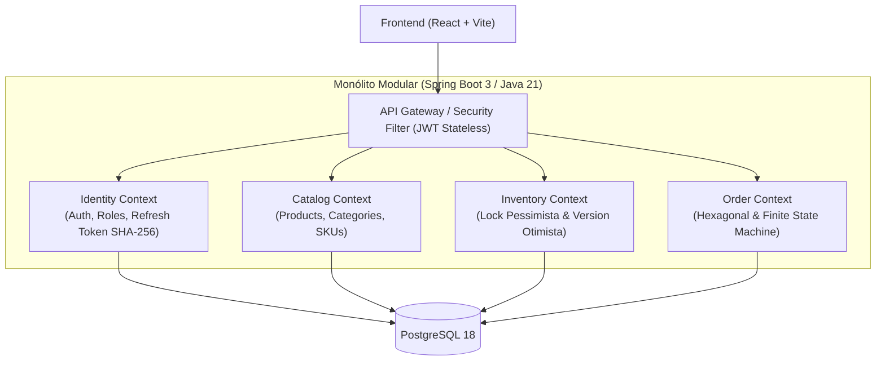

# DevUsa — Plataforma E-commerce & Showcase de Arquitetura

[](https://github.com/SEU_USUARIO/devusa/actions)


> Plataforma completa de comércio eletrônico de moda desenvolvida como **projeto de portfólio de engenharia de software**. Combina uma experiência visual minimalista de e-commerce contemporâneo com um **System Inspector ("Modo Engenheiro")** integrado que expõe em tempo real o funcionamento dos Bounded Contexts, concorrência de estoque e máquina de estados.

---

## 🏛️ Visão Geral da Arquitetura

O projeto foi construído sobre o padrão **Monólito Modular**, garantindo alto desacoplamento e isolamento de domínio com validação contínua via **ArchUnit**:



---

## 🔑 Diferenciais Técnicos Implementados

1. **Controle Estrito de Concorrência no Estoque:**
   - Reserva de estoque atômica com lock pessimista (`SELECT ... FOR UPDATE`) e controle otimista via `@Version`.
   - Garantia formal de que o estoque disponível nunca fica negativo, mesmo sob alta concorrência de checkout.
2. **Máquina de Estados Finita (Order FSM):**
   - Estados: `AGUARDANDO_PAGAMENTO` → `PAGO` → `EM_SEPARACAO` → `ENVIADO` → `ENTREGUE` (com saídas controladas `CANCELADO` e `EXPIRADO`).
   - Validação estrita de transição no modelo de domínio puro (`OrderStatus.canTransitionTo`).
3. **Segurança & Tokens:**
   - Access tokens JWT stateless de curta duração (15 minutos).
   - Refresh tokens persistidos no banco de dados com **hashing SHA-256** e **rotação obrigatória** a cada renovação para combater replay attacks.
   - RBAC granular (`CLIENTE`, `GERENTE`, `ESTOQUE`, `EXPEDICAO`).
4. **Idempotência no Checkout:**
   - Cabeçalho / campo `idempotencyKey` obrigatório na finalização de compra para evitar pedidos duplicados por múltiplos cliques.
5. **System Inspector ("Modo Engenheiro"):**
   - Gaveta flutuante no frontend que permite a qualquer recrutador ou avaliador acompanhar o log de eventos de domínio e acionar transições de estados ao vivo.

---

## 📂 Estrutura de Bounded Contexts

```text
com.devusa/
├── identity/       # Autenticação, usuários, JWT, rotação de refresh token e RBAC
├── catalog/        # Produtos, categorias, variações (tamanho/cor), SKUs e precificação
├── inventory/      # Itens de estoque, reservas temporárias e controle de concorrência
├── order/          # Pedidos, itens de compra, máquina de estados e fluxo de checkout
└── shared/         # Value objects e utilitários transversais
```

---

## 🚀 Como Executar Localmente

### Pré-requisitos
* Java 21 (JDK 21)
* Node.js 20+
* Docker & Docker Compose (opcional para rodar com Postgres local)

### 1. Iniciar o Backend
```powershell
# Subir o banco Postgres via Docker
docker compose up -d postgres

# Executar a aplicação Spring Boot
./mvnw spring-boot:run
```
*A API estará disponível em `http://localhost:8080` com Flyway executando as migrações automaticamente.*

### 2. Iniciar o Frontend
```powershell
cd frontend
npm install
npm run dev
```
*Acesse no navegador: `http://localhost:5173`.*

---

## 🧪 Suíte de Testes Automatizados
```powershell
./mvnw clean test
```
* Inclui testes de máquina de estados, regras de concorrência de inventário, hashing e rotação de tokens, além de verificação de governança modular com **ArchUnit**.

---

## 📑 Decisões de Arquitetura (ADRs)
* [ADR 001 — Monólito Modular como Arquitetura Inicial](docs/architecture/adr/001-modular-monolith.md)
* [ADR 002 — Estratégia de Tokens JWT e Refresh Token com Rotação](docs/architecture/adr/002-token-strategy.md)
* [ADR 003 — Vitrine Fullstack e System Inspector para Portfólio](docs/architecture/adr/003-showcase-and-system-inspector.md)
* [Guia de Deploy em Produção (Render + Vercel)](docs/DEPLOY.md)
