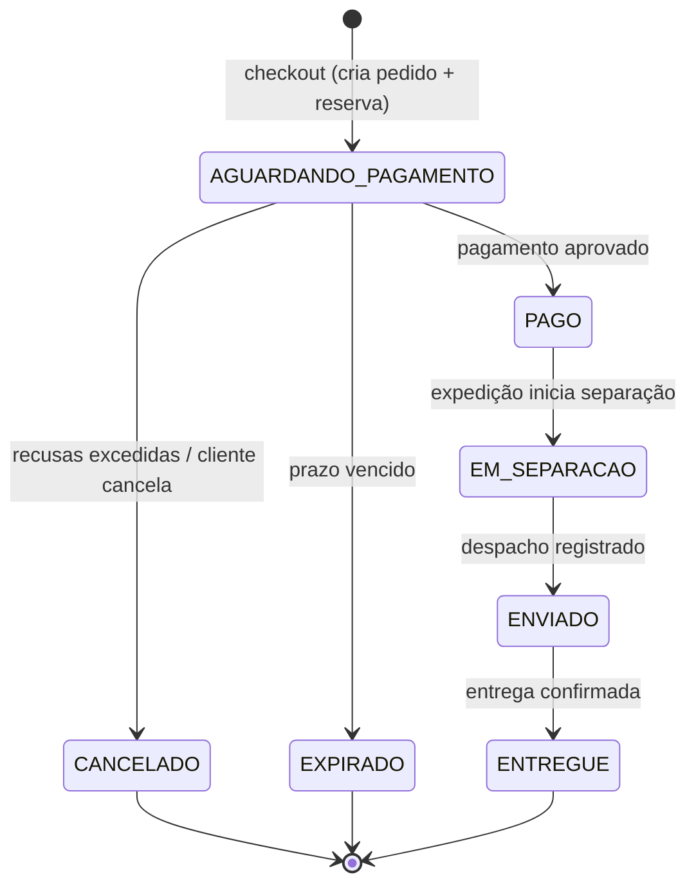

# Fluxo de checkout e ciclo de vida do pedido

Este documento descreve o fluxo de checkout do DevUsa, os estados do pedido, as transições permitidas, o tratamento de falhas e as decisões de negócio associadas.

> **Status:** rascunho em evolução. O pagamento é **simulado** no MVP, e itens marcados como *a definir* ainda dependem de decisão.

## 1. Visão geral

## 2. Fluxo feliz

1. **Iniciar checkout** a partir do carrinho.
2. **Recalcular preço e disponibilidade.** É uma validação antecipada: confirma que preços e quantidades continuam válidos, mas **não garante** o estoque (quem garante é a reserva).
3. **Criar o pedido e reservar o estoque, na mesma transação.** O pedido guarda o nome e o preço de cada item no momento da compra e nasce em `AGUARDANDO_PAGAMENTO`, com prazo de expiração.
4. **Pagar.** O cliente faz uma tentativa de pagamento (simulada).
5. **Confirmar o pedido.** Com o pagamento aprovado, o pedido vai para `PAGO` e a reserva vira baixa definitiva no estoque.
6. **Separar, enviar e entregar.** A expedição conduz o pedido por `EM_SEPARACAO`, `ENVIADO` e `ENTREGUE`.

**Por que reservar antes de pagar?** Se o pagamento viesse primeiro, o cliente poderia ser cobrado por um item que acabou. Reservando antes, o pior caso é estoque preso por um tempo limitado, e a expiração resolve isso.

**Liberar a reserva** não faz parte do fluxo feliz: acontece nos fluxos de falha (recusa, cancelamento ou expiração).

## 3. Estados do pedido

| Estado | Tipo | Significado | Quem muda para ele |
|---|---|---|---|
| `AGUARDANDO_PAGAMENTO` | Intermediário | Pedido criado e estoque reservado, aguardando pagamento dentro do prazo. | Cliente (checkout) |
| `PAGO` | Intermediário | Pagamento aprovado; reserva convertida em baixa definitiva. | Gateway de pagamento (simulado) |
| `EM_SEPARACAO` | Intermediário | Pedido sendo separado pela expedição. | Funcionário de expedição |
| `ENVIADO` | Intermediário | Pedido despachado. | Funcionário de expedição |
| `ENTREGUE` | Final | Entrega confirmada. | Funcionário de expedição (manual no MVP) |
| `CANCELADO` | Final | Cancelado pelo cliente ou por recusas de pagamento excedidas. | Cliente / Sistema |
| `EXPIRADO` | Final | Prazo de pagamento venceu sem aprovação. | Sistema (rotina agendada) |

`CANCELADO` e `EXPIRADO` têm o mesmo efeito no estoque (liberam a reserva), mas são mantidos separados porque contam histórias diferentes: desistência ou recusa versus abandono. Isso importa para indicadores.

## 4. Transições permitidas

| Origem | Destino | Disparo | Quem dispara | Evento gerado |
|---|---|---|---|---|
| (início) | `AGUARDANDO_PAGAMENTO` | Checkout concluído (pedido + reserva numa transação) | Cliente | `PedidoCriado` |
| `AGUARDANDO_PAGAMENTO` | `PAGO` | Pagamento aprovado | Gateway simulado | `PagamentoAprovado` |
| `AGUARDANDO_PAGAMENTO` | `CANCELADO` | Recusas excedidas ou cancelamento pelo cliente | Sistema / Cliente | `PedidoCancelado` |
| `AGUARDANDO_PAGAMENTO` | `EXPIRADO` | Prazo vencido | Rotina agendada | `PedidoExpirado` |
| `PAGO` | `EM_SEPARACAO` | Início da separação | Expedição | `SeparacaoIniciada` |
| `EM_SEPARACAO` | `ENVIADO` | Despacho registrado | Expedição | `PedidoEnviado` |
| `ENVIADO` | `ENTREGUE` | Entrega confirmada | Expedição | `PedidoEntregue` |

Regras gerais:

- Qualquer transição fora desta tabela é **rejeitada**.
- Cada mudança de estado só é aplicada se o pedido ainda estiver no estado de origem esperado (mudança condicional). Isso evita que duas operações simultâneas sobrescrevam uma à outra.
- Toda mudança é registrada no histórico: estado anterior, novo estado, momento e quem causou.

## 5. Reserva de estoque e tentativas de pagamento

### Reserva

`ATIVA` → `CONSUMIDA` (pagamento aprovado) ou `LIBERADA` (pedido cancelado ou expirado).

- Só é possível sair de `ATIVA`. É isso que garante que liberar a reserva duas vezes não altera o estoque.
- O prazo da reserva é o **mesmo do pedido**: uma única fonte de verdade para a expiração.

### Tentativa de pagamento

`PENDENTE` → `APROVADA` ou `RECUSADA`.

- Um pedido pode ter até **2 tentativas**.
- Cada tentativa tem um identificador próprio, usado para garantir idempotência ao receber a confirmação.

## 6. Decisões

| # | Decisão | Justificativa |
|---|---|---|
| D1 | A reserva começa na criação do pedido, junto com ele. | Evita pedidos sem reserva e pedidos órfãos. |
| D2 | Prazo de pagamento inicial de **15 minutos**, configurável. | Tempo razoável para pagar sem prender estoque por muito tempo. Valor inicial, a ajustar. |
| D3 | Pagamento recusado: até **2 tentativas** dentro do prazo. Excedidas, o pedido vai para `CANCELADO` e a reserva é liberada. | Permite corrigir um erro sem prender o estoque indefinidamente. |
| D4 | Fechar a página não cancela o pedido: ele aguarda o prazo e expira. | O servidor não detecta com confiança que a sessão foi fechada. |
| D5 | Meio de pagamento (cartão, Pix etc.): **a definir**. O MVP trabalha com "tentativa de pagamento" simulada. | Evita fixar detalhes de um provedor ainda não escolhido. |
| D6 | Cancelamento depois de `PAGO` está **fora do MVP**. | Exige estorno e reverter a baixa de estoque. |
| D7 | Pagamento aprovado depois da expiração: o pedido continua `EXPIRADO` e o pagamento é marcado para estorno simulado. | Evita "ressuscitar" pedido cujo estoque pode ter sido vendido a outra pessoa. |
| D8 | A entrega é confirmada manualmente pela expedição. | Integração com logística está fora do MVP. |
| D9 | Estratégia de controle de concorrência do estoque (update atômico, otimista ou pessimista): **a definir**. | Será decidida após o teste de concorrência da fase de estoque e registrada em um ADR. |

## 7. Tratamento de falhas

| Situação | Comportamento |
|---|---|
| Cliente fecha a página durante o pagamento | O pedido permanece `AGUARDANDO_PAGAMENTO` até o prazo. Sem pagamento, a rotina de expiração marca `EXPIRADO` e libera a reserva. |
| Mesma confirmação de pagamento chega duas vezes | A confirmação é identificada pelo id da tentativa de pagamento. A segunda é ignorada, sem alterar o banco, e responde sucesso. |
| Dois clientes tentam comprar a última unidade | A reserva checa e reduz o estoque de forma controlada contra concorrência. Quem concluir primeiro reserva; o outro recebe "estoque indisponível". |
| Preço muda entre o carrinho e o checkout | O recálculo detecta a diferença, o checkout é interrompido e o cliente precisa confirmar o novo valor antes do pedido ser criado. |
| Item sem estoque no recálculo | O checkout é interrompido e o cliente é informado. Remover o item automaticamente: **a definir**. |
| Aprovação chega depois da expiração | Aplica-se D7: pedido continua `EXPIRADO`, pagamento marcado para estorno simulado e cliente notificado. |
| Expiração e aprovação simultâneas | A mudança de estado é condicional: só vale se o pedido ainda estiver `AGUARDANDO_PAGAMENTO`. Quem chegar primeiro vence, e a outra operação é descartada. |
| Duplo clique em "finalizar compra" | O checkout usa uma chave de idempotência (ou a regra de um pedido aguardando pagamento por carrinho), para não criar dois pedidos nem duas reservas. |
| Recusas excedidas | O pedido vai para `CANCELADO` e a reserva é liberada. |

## 8. Pontos em aberto

- Meio de pagamento do MVP (D5).
- Estratégia de concorrência do estoque (D9).
- Remoção automática de itens sem estoque no recálculo.
- Quem cadastra produtos e preços (definido no README).
